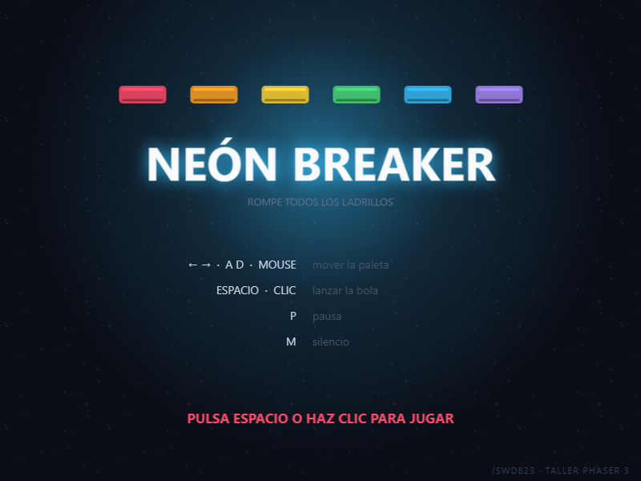
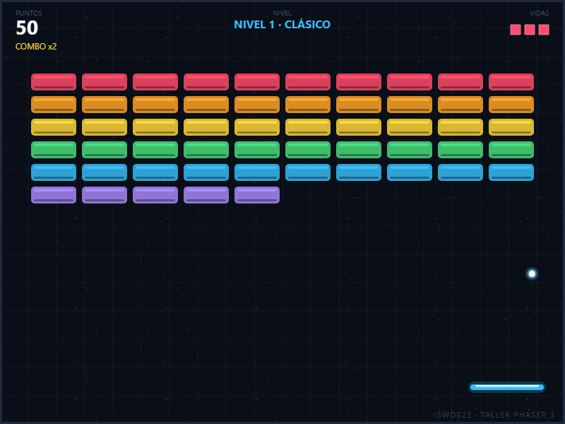

# NEÓN BREAKER — Taller Práctico: Setup, Desarrollo y Despliegue con Phaser 3

Juego tipo **Arkanoid / Breakout** hecho con **Phaser 3 (CDN, sin build)** y publicado en
**GitHub Pages**. Es la resolución del reto individual del taller: un juego propio, terminado y
jugable, con tres niveles, power-ups, puntaje y récord.

**Autor:** Axel Manotoa · **Curso:** ISWD823 · **Repositorio:** `manotoa-axel-jueg-gr3`

> **Entrega:** enlace público de GitHub Pages + enlace del repositorio en el canal de Teams.
> - Juego: https://2026b-sof-jueg-gr3.github.io/manotoa-axel-jueg-gr3/
> - Código: https://github.com/2026B-Sof-Jueg-Gr3/manotoa-axel-jueg-gr3




---

## ¿Por qué este juego?

El documento *Carrito* es **un ejemplo de metodología**, no el juego que hay que entregar. Había que
elegir uno propio. Se eligió el rompe-ladrillos porque:

- **Es popular y se entiende en tres segundos**: todo el mundo conoce Arkanoid.
- **Es fácil de programar**: no necesita mapas, ni IA, ni animaciones complejas.
- **Pero da juego técnico**: rebotes con ángulo, colisiones contra grupos de objetos, power-ups,
  niveles, puntaje y estados de partida. Se lucen más conceptos que con un juego de una sola tecla.
- **Encaja con el taller**: es un solo lienzo de 800 × 600, sin assets externos, y corre en
  GitHub Pages sin compilar.

---

## 1. Estructura del proyecto

```
manotoa-axel-jueg-gr3/
├── index.html                 # Punto de entrada · Phaser por CDN
├── game.js                    # Configuración del juego (Paso 4 del taller)
├── js/
│   ├── util.js                # Récord en localStorage + sonido con WebAudio
│   ├── niveles.js             # Medidas del tablero y los 3 niveles
│   ├── texturas.js            # Assets procedurales (bola, paleta, ladrillos, power-ups)
│   └── escenas/
│       ├── BootScene.js       # Arranque
│       ├── PreloaderScene.js  # Barra de avance + generación de texturas
│       ├── MenuScene.js       # Título, controles y récord
│       ├── JuegoScene.js      # Núcleo: paleta, bola, ladrillos, power-ups, HUD
│       └── FinScene.js        # Game over / victoria
├── docs/
│   ├── ANALISIS.md            # Análisis del material + decisiones
│   ├── ENTREGA.md             # Checklist y mensaje de Teams
│   └── capturas/
└── README.md
```

Sin `node_modules`, sin bundler, sin paso de compilación: lo que se sube es lo que se ejecuta.

---

## 2. Ejecutarlo en local

**Opción A — Live Server (la del Paso 5 del taller)**

1. Instala la extensión **Live Server** en VS Code.
2. Clic derecho sobre `index.html` → **Open with Live Server**.
3. Abre `http://127.0.0.1:5500`.

**Opción B — servidor de Python**

```bash
python -m http.server 8000
# luego abre http://localhost:8000
```

---

## 3. Los 8 pasos del taller

### Paso 1 · Creación del repositorio

1. Entra a la organización **`2026B-Sof-Jueg-Gr3`** en GitHub.
2. Clic en **New**.
3. Nombre **estricto**: `manotoa-axel-jueg-gr3` (minúsculas, con guiones).
4. Visibilidad **Public** y marca **Add a README file**.

### Paso 2 · Clonar y preparar el entorno

```bash
git clone https://github.com/2026B-Sof-Jueg-Gr3/manotoa-axel-jueg-gr3.git
cd manotoa-axel-jueg-gr3
```

Copia aquí el contenido de este proyecto (`index.html`, `game.js`, `js/`, `docs/`).

### Paso 3 · `index.html`

Phaser por CDN, sin instalar nada:

```html
<script src="https://cdn.jsdelivr.net/npm/phaser@3.90.0/dist/phaser.min.js"></script>
```

### Paso 4 · `game.js`

```js
const CONFIG = {
  type: Phaser.AUTO,
  parent: 'juego',
  width: 800,
  height: 600,
  physics: { default: 'arcade', arcade: { gravity: { y: 0 }, debug: false } },
  scale: { mode: Phaser.Scale.FIT, autoCenter: Phaser.Scale.CENTER_BOTH },
  scene: [BootScene, PreloaderScene, MenuScene, JuegoScene, FinScene]
};

const juego = new Phaser.Game(CONFIG);
```

### Paso 5 · Probar localmente

Live Server y jugar: mover con **← →** o **A D**, lanzar con **espacio**.

### Paso 6 · Commit y push

```bash
git status
git add .
git commit -m "feat: setup inicial"
git push origin main
```

### Paso 7 · Despliegue en GitHub Pages

1. **Settings** ⚙️ → sección **Pages**.
2. *Source*: **Deploy from a branch**.
3. *Branch*: `main` y carpeta **/(root)** → **Save**.
4. Espera 1–3 minutos y recarga.

```
https://2026b-sof-jueg-gr3.github.io/manotoa-axel-jueg-gr3/
```

### Paso 8 · Entrega en Teams

```
Mi Proyecto Phaser — Axel Manotoa
Link al juego: https://2026b-sof-jueg-gr3.github.io/manotoa-axel-jueg-gr3/
Link al código: https://github.com/2026B-Sof-Jueg-Gr3/manotoa-axel-jueg-gr3
```

Y jugar y comentar el proyecto de **al menos dos compañeros**.

---

## 4. Cómo se cumple cada requisito del taller

| Requisito | Dónde |
|---|---|
| `index.html` con Phaser por CDN | `index.html` |
| `game.js` con la configuración | `game.js` |
| `preload()` | `PreloaderScene.preload()` (listo para assets reales) |
| `create()` | `JuegoScene.create()` |
| `update()` | `JuegoScene.update()` |
| Física arcade | `game.js` + cuerpos de bola, paleta y ladrillos |
| Movimiento por teclado | `JuegoScene.moverPaleta()` (flechas y A/D) |
| Cámara | `cameras.main.shake()` en cada impacto (aquí no se sigue al jugador: el tablero cabe entero en pantalla, así que la cámara se usa para dar impacto) |
| Despliegue en Pages | Sin build, `index.html` en la raíz de `main` |

---

## 5. Mecánicas del juego

| Elemento | Comportamiento |
|---|---|
| **Paleta** | Se mueve con ← → / A D o con el mouse. El ángulo de salida depende de **dónde** golpea la bola: centro = recto, borde = diagonal. |
| **Bola** | Rebota con elástica total. Se acelera un poco con cada ladrillo roto (hasta 640). |
| **Ladrillos** | 6 colores. En el nivel 2 y 3 las filas de arriba aguantan **2 golpes** (se aclaran al primero). |
| **Combo** | Cada ladrillo roto sin tocar la paleta sube el multiplicador (x2, x3… hasta x5). Se reinicia al tocar la paleta. |
| **Power-ups** | Caen de vez en cuando (14 %): **paleta ancha** (9 s), **multibola** (+2 bolas), **vida extra**. |
| **Vidas** | 3 (máximo 5). Se pierde al dejar caer todas las bolas. |
| **Niveles** | 3: CLÁSICO (60 ladrillos), PIRÁMIDE (40) y MURALLAS (40, con dobles). Al limpiar uno, +100 puntos. |
| **Fin** | Sin vidas → *Game Over*; nivel 3 limpio → *Victoria*. El puntaje se guarda como récord en el navegador. |

**Controles:** ← → / A D / mouse · **ESPACIO o clic** lanzar · **P o ESC** pausa · **M** silencio.

---

## 6. Dónde tocar si quieres cambiar el juego

| Quiero… | Archivo | Qué cambiar |
|---|---|---|
| Otra dificultad | `js/niveles.js` | `velocidad` de cada nivel |
| Otra disposición de ladrillos | `js/niveles.js` | la función `patron(fila, columna)` |
| Más o menos filas | `js/niveles.js` | `filas` del nivel |
| Paleta más rápida | `js/niveles.js` | `VEL_PALETA` |
| Más vidas | `js/niveles.js` | `VIDAS` |
| Más/menos power-ups | `js/escenas/JuegoScene.js` | el `Math.random() < 0.14` |
| Ver las cajas de colisión | `game.js` | `arcade.debug: true` |
| Otro tamaño de ventana | `game.js` | `width` / `height` (el tablero se recalcula) |

---

## 7. Nota sobre el material del curso

El documento *Carrito* (Phaser 4 + Vite) y su presentación sirven como **referencia de arquitectura**
—escenas separadas, preloader, menú, juego y pantalla final— y no como el juego a entregar. Este
proyecto toma esa arquitectura, pero con **Phaser 3 por CDN**, que es lo que exige el taller y lo que
permite publicar en `/(root)` sin compilar.

Los assets son **procedimentales** (se dibujan con `Graphics` y `createCanvas`), así que el juego pesa
menos de 60 KB de código, no descarga imágenes y no tiene problemas de CORS al publicarse.
