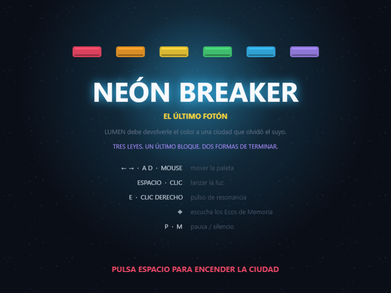
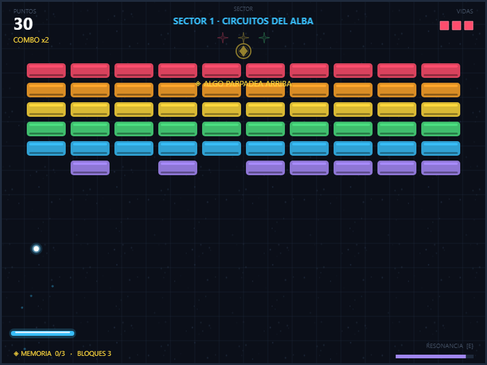

# NEÓN BREAKER — El Último Fotón

Juego tipo **Arkanoid / Breakout** hecho con **Phaser 3 (CDN, sin build)** y publicado en
**GitHub Pages** e **Itch.io**. Incluye landing page inmersiva, narrativa jugable, marco legal y
CI/CD automático con GitHub Actions.

> **Logline:** LUMEN, el último fotón de una ciudad que olvidó su color, rompe los bloques del
> Apagón para devolverle la luz — sin saber que cada bloque es un recuerdo suyo, y que el último
> que quede en pie decidirá si la ciudad vuelve a brillar **o vuelve a recordar**.

**Autor:** Axel Manotoa · **Curso:** ISWD823 · **Repositorio:** `manotoa-axel-jueg-gr3`

> **Enlaces:**
> - Landing Page: https://2026b-sof-jueg-gr3.github.io/manotoa-axel-jueg-gr3/
> - Juego directo: https://2026b-sof-jueg-gr3.github.io/manotoa-axel-jueg-gr3/juego/index.html
> - Código: https://github.com/2026B-Sof-Jueg-Gr3/manotoa-axel-jueg-gr3
> - Itch.io: https://axel112004.itch.io/neon-breaker




---

## ¿Por qué este juego?

El documento *Carrito* es **un ejemplo de metodología**, no el juego que hay que entregar. Había que
elegir uno propio. Se eligió el rompe-ladrillos porque:

- **Es popular y se entiende en tres segundos**: todo el mundo conoce Arkanoid.
- **Es fácil de programar**: no necesita mapas, ni IA, ni animaciones complejas.
- **Pero da juego técnico**: rebotes con ángulo, colisiones contra grupos de objetos, power-ups,
  niveles, puntaje y estados de partida. Se lucen más conceptos que con un juego de una sola tecla.
- **Encaja con el taller**: es un solo lienzo de 800 × 600, sin assets externos, y corre en
  GitHub Pages sin compilar.

---

## 1. Estructura del proyecto

```
manotoa-axel-jueg-gr3/
├── index.html                 # Landing page inmersiva (Misión 3 del taller 2)
├── juego/
│   └── index.html             # Canvas de Phaser (el juego)
├── game.js                    # Configuración del juego
├── js/
│   ├── util.js                # Récord, formato de tiempo, sonido WebAudio
│   ├── historia.js            # Logline, Lore (3 Leyes), giros, finales y Sello
│   ├── niveles.js             # Medidas del tablero y los 3 sectores
│   ├── texturas.js            # Assets procedurales (+ Eco y Último Fotón)
│   └── escenas/
│       ├── BootScene.js       # Arranque
│       ├── PreloaderScene.js  # Barra de avance + generación de texturas
│       ├── MenuScene.js       # Título, leyes, controles, Sello persistente
│       ├── JuegoScene.js      # Ecos, Resonancia, sectores y EL NÚCLEO
│       ├── InterludioScene.js # El giro narrativo
│       └── FinScene.js        # Dos finales, Sello, rango y Código de Luz
├── .github/
│   └── workflows/
│       └── deploy-itchio.yml  # CI/CD: despliegue automático a Itch.io
├── docs/
│   ├── ANALISIS.md            # Análisis del material + decisiones
│   ├── ENTREGA.md             # Entrega del taller 1
│   ├── ENTREGA-TALLER2.md     # Entrega de Pre-Producción y CI/CD
│   ├── PREPRODUCCION.md       # Análisis de las 4 misiones + CI/CD
│   └── capturas/
└── README.md
```

Sin `node_modules`, sin bundler, sin paso de compilación: lo que se sube es lo que se ejecuta.

---

## 2. Ejecutarlo en local

**Opción A — Live Server (la del Paso 5 del taller)**

1. Instala la extensión **Live Server** en VS Code.
2. Clic derecho sobre `index.html` → **Open with Live Server**.
3. Abre `http://127.0.0.1:5500`.

**Opción B — servidor de Python**

```bash
python -m http.server 8000
# luego abre http://localhost:8000
```

---

## 3. Los 8 pasos del taller

### Paso 1 · Creación del repositorio

1. Entra a la organización **`2026B-Sof-Jueg-Gr3`** en GitHub.
2. Clic en **New**.
3. Nombre **estricto**: `manotoa-axel-jueg-gr3` (minúsculas, con guiones).
4. Visibilidad **Public** y marca **Add a README file**.

### Paso 2 · Clonar y preparar el entorno

```bash
git clone https://github.com/2026B-Sof-Jueg-Gr3/manotoa-axel-jueg-gr3.git
cd manotoa-axel-jueg-gr3
```

Copia aquí el contenido de este proyecto (`index.html`, `game.js`, `js/`, `docs/`).

### Paso 3 · `index.html`

Phaser por CDN, sin instalar nada:

```html
<script src="https://cdn.jsdelivr.net/npm/phaser@3.90.0/dist/phaser.min.js"></script>
```

### Paso 4 · `game.js`

```js
const CONFIG = {
  type: Phaser.AUTO,
  parent: 'juego',
  width: 800,
  height: 600,
  physics: { default: 'arcade', arcade: { gravity: { y: 0 }, debug: false } },
  scale: { mode: Phaser.Scale.FIT, autoCenter: Phaser.Scale.CENTER_BOTH },
  scene: [BootScene, PreloaderScene, MenuScene, JuegoScene, InterludioScene, FinScene]
};

const juego = new Phaser.Game(CONFIG);
```

### Paso 5 · Probar localmente

Live Server y jugar: mover con **← →** o **A D**, lanzar con **espacio**.

### Paso 6 · Commit y push

```bash
git status
git add .
git commit -m "feat: setup inicial"
git push origin main
```

### Paso 7 · Despliegue en GitHub Pages

1. **Settings** ⚙️ → sección **Pages**.
2. *Source*: **Deploy from a branch**.
3. *Branch*: `main` y carpeta **/(root)** → **Save**.
4. Espera 1–3 minutos y recarga.

```
https://2026b-sof-jueg-gr3.github.io/manotoa-axel-jueg-gr3/
```

### Paso 8 · Entrega en Teams

```
Mi Proyecto Phaser — Axel Manotoa
Link al juego: https://2026b-sof-jueg-gr3.github.io/manotoa-axel-jueg-gr3/
Link al código: https://github.com/2026B-Sof-Jueg-Gr3/manotoa-axel-jueg-gr3
```

Y jugar y comentar el proyecto de **al menos dos compañeros**.

---

## 4. Cómo se cumple cada requisito del taller

| Requisito | Dónde |
|---|---|
| `index.html` con Phaser por CDN | `index.html` |
| `game.js` con la configuración | `game.js` |
| `preload()` | `PreloaderScene.preload()` (listo para assets reales) |
| `create()` | `JuegoScene.create()` |
| `update()` | `JuegoScene.update()` |
| Física arcade | `game.js` + cuerpos de bola, paleta y ladrillos |
| Movimiento por teclado | `JuegoScene.moverPaleta()` (flechas y A/D) |
| Cámara | `cameras.main.shake()` en cada impacto (aquí no se sigue al jugador: el tablero cabe entero en pantalla, así que la cámara se usa para dar impacto) |
| Despliegue en Pages | Sin build, `index.html` en la raíz de `main` |

---

## 5. Mecánicas del juego

| Elemento | Comportamiento |
|---|---|
| **Paleta** | ← → / A D / mouse. El ángulo de salida depende de **dónde** golpea la bola: centro = recto, borde = diagonal. Es la Ley I (incidencia = reflexión). |
| **Bola (LUMEN)** | Rebote elástico total. Se acelera con cada ladrillo roto (hasta 640). |
| **Ladrillos** | 6 colores. Sectores 2 y 3 tienen filas de **2 golpes**. Cada uno roto borra el nombre de lo que iluminaba. |
| **Combo** | Cada ladrillo sin tocar la paleta sube el multiplicador (hasta x5). Se reinicia al tocar la paleta. |
| **Ecos de Memoria** | Un rombo `◈` oculto por sector. Tocarlo con la bola revela una de las **3 Leyes de la Luz** y suma MEMORIA, puntos y resonancia. |
| **Pulso de Resonancia** | `E` o clic derecho: curva la trayectoria de la bola cercana sin romper nada. Consume 25 de energía; se recarga al romper bloques y al descubrir leyes. |
| **Gemas de color** | Tres estrellas en el HUD que se encienden al restaurar cada sector. El fondo también se satura con el progreso. |
| **La voz del Apagón** | Un susurro distinto por sector y consejos de física diegéticos cuando haces algo notable. |
| **Power-ups** | 14 %: **paleta ancha** (9 s), **multibola** (+2 bolas), **vida extra**. |
| **Vidas** | 3 (máximo 5). |
| **Sectores** | 3: CIRCUITOS DEL ALBA (60), TORRE DE FRECUENCIAS (40), ARCHIVO DEL APAGÓN (40). |
| **Interludio** | Al limpiar el tercer sector, el juego se detiene y revela el giro: los bloques eran recuerdos y el Apagón era la sombra de LUMEN. |
| **El Núcleo** | Un único bloque dorado y la orden engañosa «ROMPE EL ÚLTIMO FOTÓN». |
| **Dos finales** | Romperlo → *La ciudad brilla, pero nadie recuerda por qué* (se puede reintentar sin perder puntos). No romperlo → **final verdadero**, con Sello, rango, estadísticas y Código de Luz persistente. |
| **Truco secreto** | Mantener `R` en el Núcleo, o dejar caer la bola a propósito (justo lo que el juego te castigó por hacer durante tres sectores). |

**Controles:** ← → / A D / mouse · **ESPACIO o clic** lanzar · **E** resonancia · **◈ R** el secreto · **P o ESC** pausa · **M** silencio.

> La narrativa completa, el giro y la justificación de Lore/Resonancia/Identidad están explicados
> en `docs/PREPRODUCCION.md`. Todos los textos viven en `js/historia.js`.

---

## 6. Dónde tocar si quieres cambiar el juego

| Quiero… | Archivo | Qué cambiar |
|---|---|---|
| Otra dificultad | `js/niveles.js` | `velocidad` de cada nivel |
| Otra disposición de ladrillos | `js/niveles.js` | la función `patron(fila, columna)` |
| Más o menos filas | `js/niveles.js` | `filas` del nivel |
| Paleta más rápida | `js/niveles.js` | `VEL_PALETA` |
| Más vidas | `js/niveles.js` | `VIDAS` |
| Más/menos power-ups | `js/escenas/JuegoScene.js` | el `Math.random() < 0.14` |
| Ver las cajas de colisión | `game.js` | `arcade.debug: true` |
| Otro tamaño de ventana | `game.js` | `width` / `height` (el tablero se recalcula) |

---

## 7. Nota sobre el material del curso

El documento *Carrito* (Phaser 4 + Vite) y su presentación sirven como **referencia de arquitectura**
—escenas separadas, preloader, menú, juego y pantalla final— y no como el juego a entregar. Este
proyecto toma esa arquitectura, pero con **Phaser 3 por CDN**, que es lo que exige el taller y lo que
permite publicar en `/(root)` sin compilar.

Los assets son **procedimentales** (se dibujan con `Graphics` y `createCanvas`), así que el juego pesa
menos de 60 KB de código, no descarga imágenes y no tiene problemas de CORS al publicarse.
